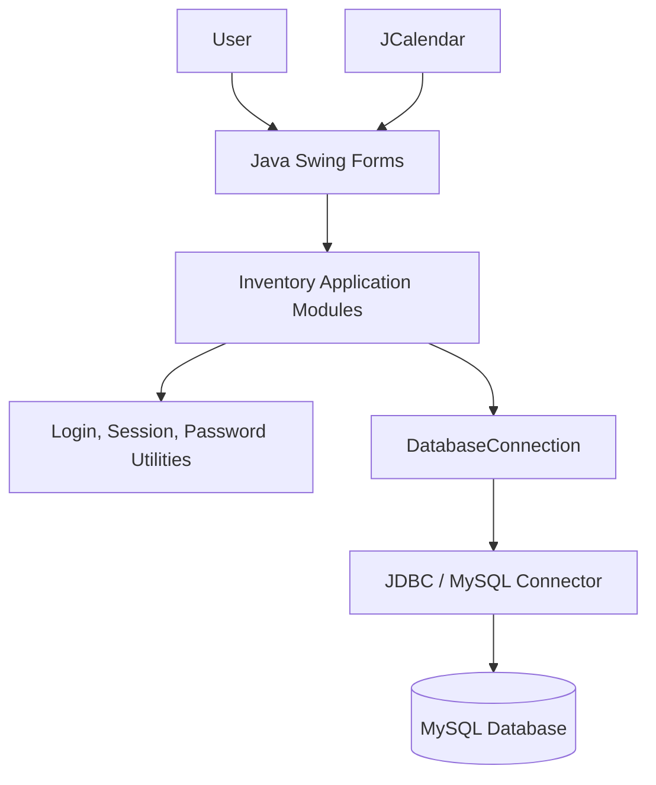

# Ventra — Inventory Management Application

Ventra is a Java desktop application developed as an **Object-Oriented Programming (PBO), Semester 3** academic project. It focuses on common inventory workflows, including product records, stock adjustments, incoming goods, outgoing goods, and delivery information.

> **Project type:** Desktop application  
> **Project context:** Academic project — Semester 3  

## 1. Application preview

The repository currently contains logo assets but does not yet include verified screenshots of the running desktop interface.

Suggested screenshots to add:
- Login window
- Main dashboard
- Product and stock management
- Incoming-goods and outgoing-goods forms
- Delivery information

Use fictional product and account data. Do not include real employee details, database records, or credentials.

## 2. Main features

- User login and account management
- Product and user master data
- Stock recording and stock adjustment
- Incoming-goods (inbound) records
- Outgoing-goods (outbound) records
- Delivery records and inventory transaction details

## 3. Technology stack

- Java 17
- Java Swing and NetBeans GUI forms
- Maven
- MySQL Connector/J 8.0.33
- JCalendar 1.4
- JDBC

## 4. Architecture overview

Ventra is structured as a Java Swing desktop application. UI forms call application classes for product, stock, inbound, outbound, and delivery operations. Database access is centralized through `DatabaseConnection`, which reads connection details from environment variables and connects to MySQL through JDBC.



## 5. Demo and local setup

A **browser-based simulation** of Ventra's inventory workflows is available in [`demo/index.html`](demo/index.html). It recreates the main dashboard, products, stock adjustment, inbound, outbound, and delivery interactions with fictional data. It is a web adaptation for portfolio viewing, not the original Java Swing executable, and it does not connect to MySQL.

To publish the demo, enable GitHub Pages at **Settings → Pages → Build and deployment → Source: GitHub Actions**, then run **Deploy browser demo** from the Actions tab. After deployment, the public URL will be: https://samuelphe.github.io/ventra-inventaris-pbo-semester3/.

The original Java application can still be run locally:

1. Install JDK 17, Maven, and MySQL or MariaDB.
2. Restore the project database named `uas3`. The repository does not currently include a complete SQL schema or database dump.
3. Set the following environment variables before launching:
   - `DB_URL` (optional; default: `jdbc:mysql://localhost:3306/uas3?serverTimezone=UTC`)
   - `DB_USER`
   - `DB_PASSWORD`
4. Build the project:

   ```bash
   mvn clean compile
   ```

5. Launch the application:

   ```bash
   mvn exec:java
   ```

The database schema must be restored from an appropriate local coursework backup before the application can operate correctly. Never use production or personal database credentials in a public repository.

## 6. Project structure

- `src/main/java/` — Swing forms, application modules, session and database classes
- `src/main/resources/images/` — logo assets
- `database/` — database preparation notes and password-hash migration
- `pom.xml` — Maven dependencies and build configuration

## 7. Copyright and license

This is a collaborative academic project developed by the following team members:

- Davent Gravando
- Marsha Marthalina
- Nicohlas
- Samuel
- Wendy Lo

This attribution recognizes the project team and does not claim that the entire project or every contribution is solely owned by Samuel Phe. Ownership and rights in jointly created materials and individual contributions remain with the respective authors or rightsholders, subject to any applicable team, course, institutional, or other agreements.

No open-source license is granted by this repository for project materials created by the team. Permission to copy, modify, redistribute, sublicense, or reuse team-created materials should be obtained from the relevant rightsholders. Java, MySQL Connector/J, JCalendar, and other third-party components remain subject to their own licenses and notices. See the [LICENSE](LICENSE) file.
---

This is an academic portfolio project and has not been presented as a production-ready inventory system. Test the application against a disposable database copy before any demonstration.


## Project team and credits

This academic project was developed collaboratively by the following team members:

- Davent Gravando
- Marsha Marthalina
- Nicohlas
- Samuel
- Wendy Lo

The names above acknowledge the project team as a whole. Individual module-level responsibilities are not assigned here because a verified task-allocation record was not provided. This credit does not imply that every member authored every file or that each contribution was identical.


## Copyright and licensing

This is a collaborative academic project credited to the team members listed above. This notice does not assign or transfer copyright and does not make a legal determination about ownership of jointly created work. Rights in individual contributions remain with their respective authors or rightsholders, subject to any applicable team, course, institutional, or other agreements. No open-source license is granted by this repository. Permission to reuse team-created materials should be obtained from the relevant rightsholders. Third-party libraries and assets remain subject to their own licenses and notices. See [LICENSE](LICENSE).
